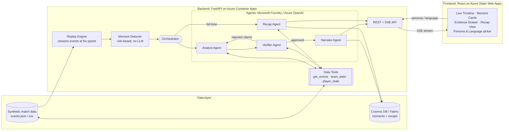
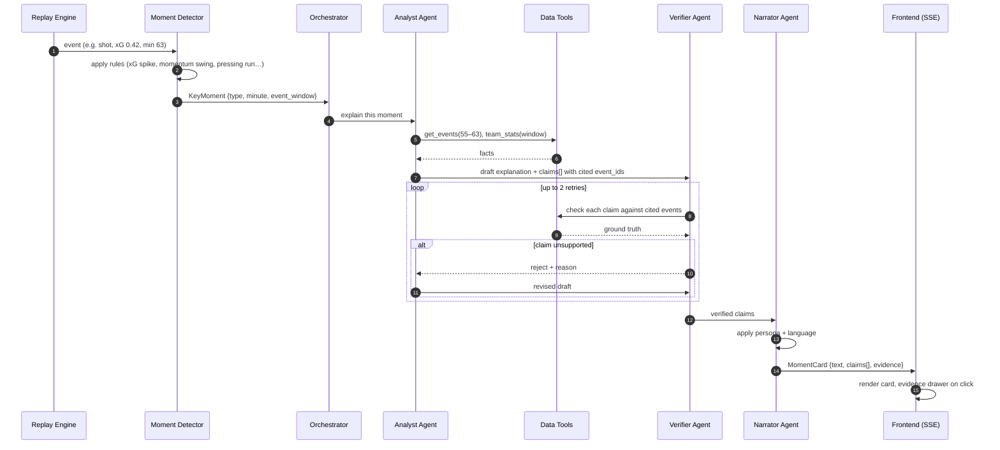
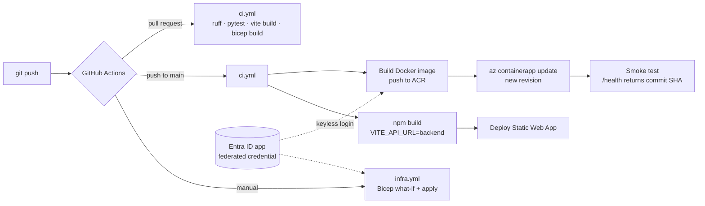

# Explain That Moment: Project Plan

> **Hackathon:** Inside the Game: Developer Hackathon (Microsoft × Premier League)
> **Submission deadline:** Oct 27, 2026, 11:59 PM PT (target: submit by **Oct 27 noon**)
> **Status:** Planning, last updated Oct 22, 2026

---

## 1. One-line pitch

A live match co-pilot that **detects key moments**, **explains them with evidence you can click**, and **writes a recap at full time** that fits each fan's preferences and language. Every AI claim is checked against the match data before anyone sees it.

### The problem
AI-generated commentary is easy to make, but broadcasters and studios **can't trust it on air**: models invent stats, players and events. Explainable match intelligence needs every claim to trace back to the data.

### Our answer
A multi-agent pipeline where a **Verifier agent** must approve every claim against the match events before it reaches a fan. The UI shows the evidence for each sentence.

---

## 2. How we score on the judging criteria

| Criterion (20% each) | How we cover it |
|---|---|
| **Technological Implementation** | Clean Python package, typed models, unit tests, GitHub Actions CI, IaC deployment, Foundry and Azure OpenAI |
| **Agentic Design & Innovation** | 4 specialized agents plus an orchestrator, tool calling, a **Verifier feedback loop** that rejects or rewrites unsupported claims |
| **Real-World Impact** | Solves the trust problem for broadcasters and studios; runs in multiple languages; deployed and usable live |
| **User Experience & Presentation** | Live timeline, moment cards, a "show evidence" drawer, persona and language switcher, 3-minute demo video |
| **Category Adherence** | Explainable match intelligence, real-time narratives, automated recaps, multilingual output and personalization (the exact words in the brief) |

---

## 3. System architecture



---

## 4. Agent pipeline: what happens for one key moment



---

## 5. Agent roles

| Agent | Input | Output | Tools | Notes |
|---|---|---|---|---|
| **Moment Detector** (code, no LLM) | Event stream | `KeyMoment` | none | Fast, cheap, testable. Rules: goal, big chance (xG ≥ 0.3), momentum swing (rolling xG/possession delta), card, sub with an impact, pressing sequence |
| **Analyst** | `KeyMoment` + event window | Draft explanation + `Claim[]` (each with `event_ids`) | `get_events`, `team_stats`, `player_stats` | Must cite event IDs for every factual claim |
| **Verifier** | Draft + claims | Verified claims, or rejection with reasons | same data tools | Approves only claims the data supports; max 2 retries, then drops the claim |
| **Narrator** | Verified claims + persona + language | Final moment text | none | Personas: *Casual Fan*, *Tactics Nerd*, *Home/Away Supporter*, *Broadcaster* |
| **Recap Agent** | All verified moments + final stats | Full-time recap (headline, story, top 3 moments, player of the match) | data tools | Runs at full time; also verified |
| **Orchestrator** | Moments queue | Routes work, handles retries and timeouts | none | Plain Python (Agent Framework / Semantic Kernel if time allows) |

---

## 6. Core data models

```python
class MatchEvent:      # from the dataset
    id: str; minute: int; second: int
    team: str; player: str | None
    type: str          # pass, shot, tackle, foul, goal, card, sub…
    x: float; y: float # pitch coordinates
    xg: float | None
    outcome: str | None

class KeyMoment:
    id: str; minute: int
    type: str          # goal, big_chance, momentum_swing, pressing_run…
    event_ids: list[str]
    importance: float  # 0–1

class Claim:
    text: str
    event_ids: list[str]   # evidence
    status: "pending" | "verified" | "rejected"
    reason: str | None

class MomentCard:
    moment: KeyMoment
    narrative: str         # persona + language applied
    claims: list[Claim]
    language: str; persona: str
```

> ⚠️ `MatchEvent` will change to match the real hackathon dataset schema.

---

## 7. Repository structure

```
Hackathon/
├── PLAN.md                  ← this file
├── README.md                ← setup, architecture, demo link
├── .env.example
├── .github/workflows/
│   ├── ci.yml               ← lint + tests + build (PRs)
│   ├── deploy.yml           ← CI → backend + frontend deploy → smoke test (push to main)
│   └── infra.yml            ← re-apply Bicep (manual)
├── infra/main.bicep         ← all Azure resources as code
├── scripts/bootstrap.sh     ← one-time Azure + GitHub OIDC setup
├── backend/
│   ├── Dockerfile
│   ├── data/                ← synthetic match data
│   ├── app/
│   │   ├── main.py          ← FastAPI + SSE
│   │   ├── models.py        ← pydantic models (section 6)
│   │   ├── replay.py        ← replay engine
│   │   ├── detector.py      ← moment detector rules
│   │   ├── tools.py         ← data tools for agents
│   │   ├── orchestrator.py
│   │   └── agents/
│   │       ├── analyst.py
│   │       ├── verifier.py
│   │       ├── narrator.py
│   │       └── recap.py
│   ├── tests/
│   └── requirements.txt
└── frontend/
    ├── src/
    │   ├── components/      ← Timeline, MomentCard, EvidenceDrawer, RecapView, Controls
    │   └── App.tsx
    └── package.json
```

---

## 8. Step-by-step build plan

```mermaid
gantt
    title 5-day build plan
    dateFormat YYYY-MM-DD
    axisFormat %b %d
    section Foundation
    Azure setup + data + replay + detector :a1, 2026-10-22, 1d
    section Agents
    Analyst + Verifier + tools            :a2, 2026-10-23, 1d
    Narrator + Recap + API (SSE)          :a3, 2026-10-24, 1d
    section Frontend
    UI: timeline, cards, evidence, recap  :a4, 2026-10-25, 1d
    section Ship
    Deploy + CI + README                  :a5, 2026-10-26, 1d
    Demo video + SUBMIT                   :crit, a6, 2026-10-27, 1d
```

### Day 1, Oct 22: Foundation
- [ ] **Azure setup (do first, approvals take time):** subscription → Foundry project → deploy a chat model (e.g. GPT-4o / GPT-4.1) → copy endpoint and key into `.env`
- [ ] Create the GitHub repo, `.gitignore`, `.env.example`
- [ ] Add the dataset to `data/` (or write a synthetic generator if none was provided)
- [ ] `models.py`: pydantic models
- [ ] `replay.py`: stream events at configurable speed (1×, 10×, 60×)
- [ ] `detector.py`: 4–6 rules
- [ ] Unit tests for the detector
- ✅ **Done when:** `python -m app.replay` prints the key moments detected in a full match

### Day 2, Oct 23: Thinking agents
- [ ] `tools.py`: `get_events(start, end, team?)`, `team_stats(window)`, `player_stats(player, window)`
- [ ] Analyst agent with tool calling; output is a JSON `Claim[]` with `event_ids`
- [ ] Verifier agent plus retry loop in the orchestrator
- [ ] Plant a false claim on purpose and confirm the Verifier rejects it (this goes in the demo)
- ✅ **Done when:** a CLI run prints verified explanations with event citations for each moment

### Day 3, Oct 24: Storytelling + API
- [ ] Narrator agent: 4 personas × languages (EN, ES, FR, HI, AR)
- [ ] Recap agent: headline, story, top 3 moments, player of the match
- [ ] FastAPI endpoints:
  - `POST /matches/{id}/start?speed=10`
  - `GET  /matches/{id}/stream` (SSE: MomentCards)
  - `GET  /matches/{id}/recap?persona=&lang=`
  - `GET  /events/{event_id}` (evidence lookup)
- [ ] Save moments and recaps (Cosmos DB, or a JSON file as fallback)
- ✅ **Done when:** `curl` the stream and see moment cards arrive live

### Day 4, Oct 25: Frontend
- [ ] React + Vite + Tailwind setup
- [ ] Scoreboard and match clock
- [ ] Live timeline with moment markers
- [ ] Moment cards with underlined claims → **Evidence Drawer** (raw events, mini pitch map)
- [ ] Persona and language picker (regenerates text)
- [ ] Full-time recap view
- ✅ **Done when:** a full match replays in the browser at 60× speed and looks demo-ready

### Day 5, Oct 26: Ship it
- [ ] Deploy the backend to **Azure Container Apps**, the frontend to **Azure Static Web Apps**
- [ ] Secrets in env vars / Key Vault (no keys in the repo)
- [ ] GitHub Actions: lint and tests on push
- [ ] README: problem, architecture diagram, setup, tech used, how GitHub Copilot was used
- [ ] Stretch, only if everything above is done: Azure Speech audio commentary, Fabric analytics
- ✅ **Done when:** a public URL works in a fresh browser

### Day 6, Oct 27: Demo + submit
- [ ] Record the 3-minute demo video (script in section 10)
- [ ] Fill in the submission form on Innovation Studio
- [ ] **Submit by noon PT.** Buffer until the 11:59 PM deadline

---

## 9. Azure / Microsoft services used

| Service | Purpose | Priority |
|---|---|---|
| Microsoft Foundry + Azure OpenAI | Agent models and tool calling | Must |
| Azure Container Apps | Backend hosting | Must |
| Azure Static Web Apps | Frontend hosting | Must |
| GitHub + GitHub Actions + Copilot | Repo, CI, AI-assisted development | Must |
| Azure Cosmos DB | Store moments and recaps | Should (JSON fallback) |
| Azure AI Translator | Translation (or the LLM does it) | Could |
| Azure AI Speech | Spoken commentary | Stretch |
| Microsoft Fabric | Match analytics / dataset expansion | Stretch |

### CI/CD pipeline



- **No Azure secrets in GitHub:** Actions logs in with OIDC (federated credential scoped to the `production` environment).
- **No API keys in the app:** the backend's managed identity has *Cognitive Services OpenAI User* on Foundry.
- **Pipeline permissions are scoped to the resource group only.**
- Repo **variables:** `AZURE_CLIENT_ID`, `AZURE_TENANT_ID`, `AZURE_SUBSCRIPTION_ID`, `AZURE_RG`, `ACR_NAME`, `BACKEND_APP`, `BACKEND_URL`
- Repo **secrets:** `SWA_DEPLOYMENT_TOKEN`, `BUDGET_EMAIL`

---

## 10. Demo script (3 minutes)

| Time | Show |
|---|---|
| 0:00–0:20 | **Problem:** "AI commentary is easy. Trusted AI commentary isn't." |
| 0:20–0:50 | Start the match replay; moment cards appear live on the timeline |
| 0:50–1:30 | Click a claim → the Evidence Drawer shows the exact events behind it |
| 1:30–2:00 | **Verifier in action:** the log shows a hallucinated claim being caught and rewritten |
| 2:00–2:30 | Switch persona (Casual → Tactics Nerd) and language (EN → ES / HI) |
| 2:30–2:50 | Full-time recap |
| 2:50–3:00 | Architecture diagram + Azure services + impact for studios and broadcasters |

---

## 11. Risks and fallbacks

| Risk | Fallback |
|---|---|
| Foundry Agent Service quota or access delayed | Call the Azure OpenAI chat-completions API directly with our own orchestrator |
| Foundry SDK API changes or bugs | Same as above; keep the agent interface thin |
| Dataset schema differs from our models | Adapter layer in `tools.py`; only `MatchEvent` changes |
| LLM latency too high for "live" | Precompute moments for the demo match, replay from cache |
| Running out of time | Cut in this order: Speech → Fabric → Cosmos (use JSON) → personas (keep 2). **Never cut the Verifier or the deployment** |

---

## 12. Open questions

- [ ] Did the hackathon provide a synthetic dataset? What's its schema?
- [ ] Which prize category are we entering? Check the exact wording in the rules.
- [ ] Is the Azure subscription and Foundry access ready?
- [ ] Confirm the stack: **Python backend + React (TypeScript) frontend** (assumed)
