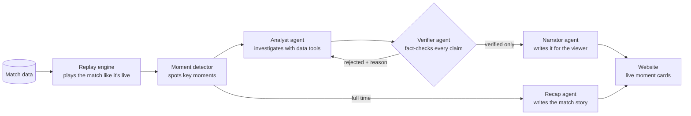
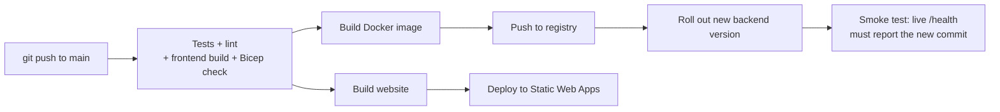

# Explain That Moment: Project Overview

> **Hackathon:** Inside the Game: Developer Hackathon (Microsoft × Premier League)
> **Submission deadline:** Oct 27, 2026, 11:59 PM PT
> **Live app:** https://zealous-dune-042411d0f.6.azurestaticapps.net
> **API docs:** https://etm-backend.jollymoss-c15ec508.eastus2.azurecontainerapps.io/docs
> **Code:** https://github.com/UmangaTripathi/explain-that-moment

---

## 1. In one sentence

**Explain That Moment** is a live football co-pilot. It watches a match as it happens, spots the moments that
matter, explains *why* they happened, and writes a full-time recap in any style and language. **Every claim is
fact-checked against the match data**, and fans can click any claim to see the proof.

---

## 2. The problem we solve

AI can write football commentary instantly, but it can't be trusted on its own:

- It **invents stats** ("a 0.65 xG chance" that never happened).
- It **mixes up players**, sometimes crediting someone who wasn't even on the pitch.
- It **states causes the data doesn't show** ("he was tired, so he fouled").

Broadcasters and studios can't put that on air. They need AI output they can **trust and check**.

**Our answer:** before anything reaches the viewer, a dedicated **Verifier agent** checks every sentence against
the actual match events. Anything it can't prove is blocked, and the reason is shown.

---

## 3. What the user sees

| Part of the screen | What it shows |
|---|---|
| **Scoreboard** | Teams, live score, match clock, LIVE badge, and a trust counter (*"24 claims verified · 3 blocked"*) |
| **Timeline** | A bar from 0' to 90'+ with coloured markers for each key moment (goal, red card, big chance and so on) |
| **Moment cards** | A headline and short story for each key moment, with ✓ verified and ⛔ blocked counts |
| **Evidence view** | Click a card's claim to see the exact match events behind it, as a table and a **mini pitch map** |
| **Blocked claims** | Struck through and kept visible, with the Verifier's reason, e.g. *"Dani Ortega does not appear in the cited events"* |
| **Live stats** | xG, shots, possession, high regains and final-third entries, home vs away |
| **Agent activity** | A running log of what the AI agents are doing ("Analyst investigating…", "Verifier blocked claim…") |
| **Full-time recap** | Headline, match story, turning point, player of the match, key numbers |
| **Controls** | Match picker, replay speed, **viewer type** (casual fan / tactics fan), **language** (6), red-team test |

---

## 4. How it works

### Step by step, for one moment

**Example: the 91st-minute winner in match 1.**

1. **The replay engine** plays the match's events in order, sped up (e.g. 30×), as if they were live.
2. **The moment detector** sees a goal and flags it: *"GOAL Riverside Athletic: Ryan Maddox scores (xG 0.412), score now 1-2."*
3. **The Analyst agent** investigates. It calls data tools such as "get the events from minutes 81–91" and "get
   both teams' stats", then writes 2–4 claims, **each citing the event IDs that prove it**.
4. **The Verifier agent** checks each claim in two ways:
   - **Hard checks in code:** do the cited events exist? Is every player named actually in those events? Do
     the xG values and minutes match?
   - **An AI judge:** does the evidence really support the claim, or is it overstated?
5. **Rejected claims go back to the Analyst** with the reason, for up to 2 rounds. Claims that still can't be
   proven are dropped.
6. **The Narrator agent** writes the final card from **only the verified claims**, in the viewer's style and
   language.
7. **The card appears on screen** with all its evidence attached.
8. **At full time**, the **Recap agent** writes the match story from the verified moments and final stats.

---

## 5. The AI agents

| Agent | Model | Job | Key rule |
|---|---|---|---|
| **Moment detector** | none (plain code) | Find key moments: goals, red cards, big chances, pressing wins, momentum swings, super-subs | Fast, free, predictable; decides *what* is worth explaining |
| **Analyst** | gpt-5-mini | Investigate a moment with data tools; write claims with cited event IDs | No event ID, no claim |
| **Verifier** | code + gpt-5-mini | Check every claim; reject unsupported ones and send them back | Nothing unproven reaches the viewer |
| **Narrator** | gpt-4.1-mini | Turn verified claims into a headline and story for the viewer | May rephrase, never add facts |
| **Recap** | gpt-4.1-mini | Full-time story, turning point, player of the match | Uses only verified moments and real stats |

### Data tools the agents can use
- `get_events`: list the match events in a time window (each with an ID that can be cited)
- `team_stats`: xG, shots, possession, pressing, cards for a time window
- `player_stats`: one player's actions, pass accuracy and xG

### Red-team mode
When it's switched on, the system **deliberately plants one false claim** on a high-impact moment, so you can watch
the Verifier catch it. It's honest testing built into the product, and a strong demo moment.

---

## 6. The match data

There was no official dataset, so we built a **match simulator** ([backend/app/datagen.py](backend/app/datagen.py)).
It plays out a match event by event:

- Possession chains of passes, carries and dribbles, with pressing, tackles and interceptions
- Shots with an **xG model** based on distance and angle to goal
- Fouls, yellow and red cards (including second yellows), corners and substitutions
- A **momentum curve** so matches have a story: spells of dominance, comebacks, late drama

**It's realistic:** across 40 simulated matches the averages are **about 30 shots, 3.2 goals and 5 cards per
match**, close to real Premier League numbers.

### The two demo matches (fictional clubs)

| Match | Story |
|---|---|
| **match_001**: Northbridge FC 1–2 Riverside Athletic | Northbridge lead 1–0, Dani Ortega gets a **second yellow at 68'**, Riverside equalise at 76' and win it in the **91st minute** |
| **match_002**: Northbridge FC 3–2 Riverside Athletic | Northbridge come back from **0–2 down**, with the winner from a **substitute** at 69' |

---

## 7. Technology and Azure services

| Layer | What we used | Why |
|---|---|---|
| AI models | **Microsoft Foundry** (Azure AI Services): gpt-5-mini, gpt-4.1-mini | Reasoning for analysis and checking; fast, cheap model for writing |
| Backend | Python, **FastAPI**, live updates via Server-Sent Events | Streams the match and cards to the browser in real time |
| Backend hosting | **Azure Container Apps** (Docker) | Always-on, managed, logs to Log Analytics |
| Frontend | **React** + TypeScript + Vite | Fast, interactive UI |
| Frontend hosting | **Azure Static Web Apps** | Free tier, global |
| Image registry | **Azure Container Registry** | Stores backend Docker images |
| Security | **Managed identity**: no API keys anywhere | The backend proves who it is to Azure directly |
| Infrastructure | **Bicep** (infrastructure as code) | Every resource is defined in one file and can be rebuilt |
| CI/CD | **GitHub Actions** with **OIDC** login | Every push to `main` tests and deploys automatically; no passwords stored in GitHub |
| Cost control | Azure budget alert at $25/month | Emails you before costs get high |

### Azure resources (resource group `rg-explain-moment`, East US 2)

| Resource | Name |
|---|---|
| Foundry (AI Services) account + project | `etm-foundry-3hgm6dvjgab6s` / `etm-project` |
| Model deployments | `gpt-5-mini` (200K tokens/min), `gpt-4.1-mini` (150K tokens/min) |
| Container App (backend) | `etm-backend` |
| Static Web App (frontend) | `etm-frontend` |
| Container Registry | `etmacr3hgm6dvjgab6s` |
| Container Apps environment + logs | `etm-env`, `etm-logs-3hgm6dvjgab6s` |
| Backend identity | `etm-backend-id` |
| Budget | `etm-budget` ($25/month) |

---

## 8. Automatic deployment (CI/CD)

| Workflow | Runs when | What it does |
|---|---|---|
| [ci.yml](.github/workflows/ci.yml) | Pull request | Lint, backend tests, frontend build, Bicep check |
| [deploy.yml](.github/workflows/deploy.yml) | Push to `main` | CI, then deploy backend and frontend, then smoke test |
| [infra.yml](.github/workflows/infra.yml) | Manually | Preview, then apply infrastructure changes |

GitHub logs in to Azure with **OIDC**: short-lived tokens, no stored passwords, and access limited to this one
resource group.

---

## 9. What we tested and the results

| Test | Result |
|---|---|
| Backend unit tests (data realism, xG model, detector finds every goal and red card, evidence IDs are real) | ✅ 8 of 8 pass |
| Code lint (ruff) and frontend type-check and build | ✅ Clean |
| Full match replay **locally** with real AI agents (match 1) | ✅ 12 of 12 moments explained and verified, recap written |
| Full match replay **on Azure** (match 2) | ✅ 17 of 17 moments explained and verified, 0 failures, recap written |
| Red-team: planted false claim | ✅ Blocked: *"Dani Ortega does not appear in the cited events"* |
| Real AI overclaims caught | ✅ e.g. *"the events do not prove his earlier shots produced the chance he converted"* |
| Automatic deployment pipeline | ✅ All jobs green; live backend reports the deployed commit |

Each moment takes about **15–25 seconds** to analyse, verify and narrate. Up to 3 are processed at once, so cards
keep pace with a sped-up match.

---

## 10. How this meets the judging criteria

| Criterion (20% each) | How we meet it |
|---|---|
| **Technological implementation** | Clean, typed Python and TypeScript; unit tests; lint; infrastructure as code; full CI/CD; keyless security |
| **Agentic design and innovation** | 4 specialised agents plus a rule engine; tool-calling Analyst; **Verifier feedback loop** that rejects and sends back; built-in red-team test |
| **Real-world impact** | Solves the trust problem that stops broadcasters using AI commentary; multilingual and personalised; deployed and usable now |
| **User experience and presentation** | Broadcast-style live UI; one click from any claim to its proof; pitch map; visible agent activity |
| **Category fit** | Explainable match intelligence, real-time narratives, automated recaps, multiple languages, personalised for viewers |

---

## 11. How to demo it (about 3 minutes)

| Time | What to show |
|---|---|
| 0:00–0:20 | **The problem:** "AI commentary is easy. Trusted AI commentary isn't." |
| 0:20–0:50 | Open the app, pick **Northbridge v Riverside**, keep **Red-team test** on, press **Kick off**; cards start appearing |
| 0:50–1:30 | Open a card, click **Show the evidence**, click a claim's **cited events**: the table and pitch map |
| 1:30–2:00 | Find the ⛔ **blocked** claim: the planted lie and the Verifier's reason; point at the agent activity log |
| 2:00–2:30 | Switch **Viewer → Tactics fan** and **Language → Español / हिन्दी**: same verified facts, retold |
| 2:30–2:50 | Full time: the **recap** (turning point, player of the match) |
| 2:50–3:00 | Architecture diagram, Azure services, CI/CD, and the impact for studios and broadcasters |

---

## 12. Running costs

| Item | Approximate cost |
|---|---|
| Backend (1 always-on Container App instance, mostly idle) | About $10–15/month (about $0.30–0.50/day) |
| AI model calls (about 40–60 per full match replay) | Cents per match; $0 when unused |
| Container Registry (Basic) | About $5/month |
| Static Web App (Free tier), Log Analytics (low volume) | Free or a few cents |
| **Total if left running** | **About $15–20/month** (estimate; check Cost Management for actuals) |

The **$25/month budget alert** emails you at 80% of the budget, and again if Azure forecasts you'll pass 100%.
**After judging,** scale the backend to zero or delete the resource group `rg-explain-moment` to stop all costs.

---

## 13. Limitations and next steps

**Current limitations**
- Uses **synthetic** match data (no official dataset was provided). The pipeline works on any event data with the
  same shape.
- Live sessions are held in memory on one backend instance, so a restart resets a running replay.
- Translation quality depends on the writing model; there's no human review.

**What we'd add next**
- Plug in a real event feed (StatsBomb or Opta-style) through a small adapter in [tools.py](backend/app/tools.py)
- Spoken commentary with **Azure AI Speech**
- Store cards and recaps in **Cosmos DB**, and run match analytics in **Microsoft Fabric**
- Clip-ready highlight packages: a moment card plus its evidence, exported for social or broadcast
- Larger models (e.g. gpt-5.4) once the subscription has quota

---

## 14. Where everything lives

| Path | What's inside |
|---|---|
| [backend/app/datagen.py](backend/app/datagen.py) | Match simulator |
| [backend/app/detector.py](backend/app/detector.py) | Key-moment detector |
| [backend/app/tools.py](backend/app/tools.py) | Data tools for the agents |
| [backend/app/agents/](backend/app/agents/) | Analyst, Verifier, Narrator, Recap |
| [backend/app/pipeline.py](backend/app/pipeline.py) | Orchestrator: replay → detect → agents → stream |
| [backend/app/llm.py](backend/app/llm.py) | Keyless connection to the Azure models |
| [backend/app/main.py](backend/app/main.py) | Web API |
| [backend/data/](backend/data/) | The two demo matches |
| [backend/tests/](backend/tests/) | Unit tests |
| [frontend/src/](frontend/src/) | Website (React) |
| [infra/main.bicep](infra/main.bicep) | All Azure resources |
| [scripts/bootstrap.sh](scripts/bootstrap.sh) | One-time Azure and GitHub setup |
| [.github/workflows/](.github/workflows/) | CI/CD pipelines |
| [README.md](README.md) | Developer guide: setup and run instructions |
| [PLAN.md](PLAN.md) | Original project plan |
