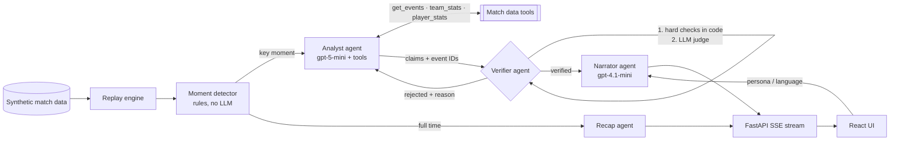

# Explain That Moment

**Verified, explainable match intelligence for broadcasters and fans.**

A live match co-pilot that detects key moments as a match unfolds, explains *why* they happened,
and writes a full-time recap in the viewer's language and style. Every sentence is checked against the match data
before anyone sees it, and every claim links to the exact events that prove it.

> Built for **Inside the Game: Developer Hackathon** (Microsoft × Premier League).

- **Live app:** https://zealous-dune-042411d0f.6.azurestaticapps.net
- **API:** https://etm-backend.jollymoss-c15ec508.eastus2.azurecontainerapps.io/docs

---

## The problem

AI-generated commentary is easy to produce and hard to trust. Language models invent stats, mix up players, and
state causes the data doesn't support. A studio can't put that on air. Explainable match intelligence needs every
claim to be traceable to the data.

## What it does

1. **Replays a match as a live feed** (synthetic, football-realistic event data).
2. **Detects key moments** with deterministic rules: goals, red cards, big chances, pressing wins, momentum swings
   and super-subs.
3. **Explains each moment with a team of agents:**
   - The **Analyst** investigates with data tools and writes claims, each citing event IDs.
   - The **Verifier** fact-checks every claim. It rejects anything unsupported and sends it back to the Analyst
     for revision.
   - The **Narrator** retells only the verified facts for a *casual* or *tactics* fan in 6 languages.
4. **Writes a full-time recap**: headline, story, turning point, player of the match.
5. **Shows its work.** Click any claim to see the cited events in a table and on a pitch map. Blocked claims stay
   visible, struck through, with the Verifier's reason.

**Red-team mode** plants one false claim during the match. In testing, the Verifier blocked it with reasons like
*"Dani Ortega does not appear in the cited events"* (he had been sent off 20 minutes earlier).

---

## Architecture



### Why the Verifier is trustworthy
The Verifier has two layers:
1. **Deterministic checks in code.** Cited events must exist. Any player named in a claim must appear in its cited
   events. Every xG value and minute in a claim must match those events.
2. **An LLM judge.** It reads each claim against the cited events and window stats, and rejects overstated causes
   or wrong outcomes.

A rejected claim goes back to the Analyst with the reason, for up to 2 rounds. The Narrator and Recap agents only
receive verified claims and are told not to add facts.

---

## Azure and Microsoft stack

| Layer | Service |
|---|---|
| Models | **Microsoft Foundry** (Azure AI Services): `gpt-5-mini` for reasoning, `gpt-4.1-mini` for writing |
| Backend | FastAPI on **Azure Container Apps** |
| Frontend | React + Vite on **Azure Static Web Apps** |
| Registry and logs | Azure Container Registry, Log Analytics |
| Identity | **Managed identity** for the backend to call the models: no API keys anywhere |
| IaC | **Bicep** ([infra/main.bicep](infra/main.bicep)), including a budget alert |
| CI/CD | **GitHub Actions** with **OIDC** federated login: no Azure secrets stored in GitHub |

### CI/CD
- **Pull request** ([ci.yml](.github/workflows/ci.yml)): ruff, pytest, frontend build, Bicep build.
- **Push to `main`** ([deploy.yml](.github/workflows/deploy.yml)): CI, then the Docker image is built, pushed to ACR
  and rolled out to Container Apps. A smoke test checks that `/health` reports the new commit. The frontend is built
  and deployed to Static Web Apps.
- **Manual** ([infra.yml](.github/workflows/infra.yml)): Bicep what-if, then apply.

---

## Repository layout

```
backend/
  app/
    datagen.py      synthetic match simulator (possession model, xG, cards, subs, momentum)
    detector.py     rule-based key-moment detector (streaming)
    tools.py        data tools the agents call
    agents/         analyst, verifier, narrator, recap
    pipeline.py     orchestrator: replay → detect → agents → stream
    llm.py          Azure OpenAI client (keyless) + tool-calling loop
    main.py         FastAPI app (REST + SSE)
  data/             two demo matches
  tests/
frontend/src/       React UI (scoreboard, timeline, moment cards, evidence drawer, recap)
infra/main.bicep    all Azure resources
scripts/bootstrap.sh  one-time Azure + GitHub OIDC setup
```

## The data

There is no official dataset, so [datagen.py](backend/app/datagen.py) simulates matches event by event. Across 40
generated matches the averages are about 30 shots, 3.2 goals and 5 cards per match, in line with the Premier League.
The two demo matches use fictional clubs:

- **match_001:** Northbridge lead 1–0, Ortega gets a second yellow at 68', and Riverside win it 2–1 in the 91st minute.
- **match_002:** Northbridge come back from 0–2 to win 3–2, with the winner from a substitute.

Regenerate or create more with `python -m app.datagen --dramatic --seed 1 --out data/match_003.json`.

---

## Run locally

Prerequisites: Python 3.12+, Node 20, and `az login` to an account with *Cognitive Services OpenAI User* on the
Foundry resource.

```bash
# backend
cd backend
python -m venv .venv && .venv/Scripts/activate   # macOS/Linux: source .venv/bin/activate
pip install -r requirements-dev.txt
cp ../.env.example .env                           # fill in the endpoint (bootstrap.sh writes this for you)
uvicorn app.main:app --reload
pytest

# frontend
cd frontend
npm install
npm run dev                                      # http://localhost:5173
```

## Deploy your own

```bash
az login && gh auth login
gh repo create <name> --public --source . --remote origin
bash scripts/bootstrap.sh     # provisions Azure, wires GitHub OIDC, sets repo variables
git push origin main          # CI/CD deploys backend + frontend
```
