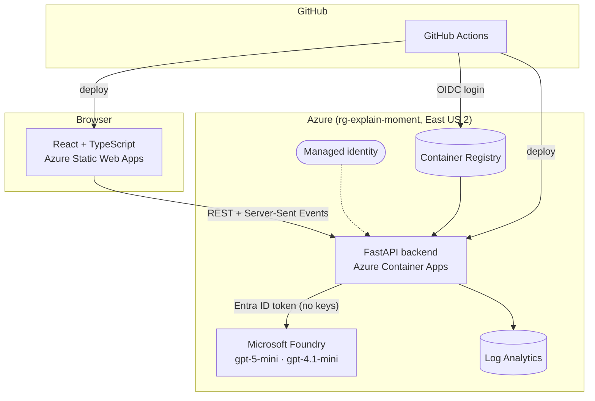

# Technology Choices: What We Used, Why, and What It Solved

This document explains every technology and major design decision in **Explain That Moment**: what it is, why we
chose it, what problem it solved, and what we'd watch out for. For setup instructions see [README.md](README.md);
for a plain-language overview see [PROJECT_OVERVIEW.md](PROJECT_OVERVIEW.md).

---

## Contents
1. [Architecture at a glance](#1-architecture-at-a-glance)
2. [AI and agents](#2-ai-and-agents)
3. [Backend](#3-backend)
4. [Data](#4-data)
5. [Frontend](#5-frontend)
6. [Azure hosting](#6-azure-hosting)
7. [Security and identity](#7-security-and-identity)
8. [Infrastructure as code](#8-infrastructure-as-code)
9. [CI/CD](#9-cicd)
10. [Quality and testing](#10-quality-and-testing)
11. [Key design decisions](#11-key-design-decisions)
12. [Known trade-offs](#12-known-trade-offs)
13. [Summary table](#13-summary-table)

---

## 1. Architecture at a glance

---

## 2. AI and agents

### Microsoft Foundry (Azure AI Services)
| | |
|---|---|
| **What** | Microsoft's platform for hosting and managing AI models on Azure |
| **Where** | [infra/main.bicep](infra/main.bicep) (account, project, model deployments), [backend/app/llm.py](backend/app/llm.py) |
| **Why** | A named hero technology for the hackathon. It gives enterprise-grade model hosting with Azure identity, quotas, monitoring and data staying in our subscription |
| **Problem solved** | We needed reliable, secure access to strong language models that a broadcaster would accept in production: no third-party keys, Azure compliance and billing |

### Two models, each matched to its job
| Model | Used by | Why this model |
|---|---|---|
| **gpt-5-mini** (reasoning) | Analyst, Verifier | These agents must *think*: decide which data to look up, connect cause and effect, judge whether evidence supports a claim. A reasoning model does this better. We set `reasoning_effort="low"` to keep latency around 15–25 s per moment |
| **gpt-4.1-mini** (fast, non-reasoning) | Narrator, Recap | These agents *rewrite* facts that are already verified, so they need fluent writing and translation, not deep reasoning. A faster, cheaper model is the right fit |

**Problem solved:** cost and speed. Using the big reasoning model for everything would make every card slower and
more expensive, for no quality gain in the writing steps.
**Note:** we planned gpt-5.4, but the new subscription had no quota for it. The model names are parameters in
Bicep and environment variables, so upgrading later is a one-line change.

### OpenAI Python SDK (`AsyncAzureOpenAI`)
| | |
|---|---|
| **Why** | The official, well-supported client for Azure OpenAI deployments. It supports tool calling, JSON output and async calls |
| **Problem solved** | Async calls let us explain **up to 3 moments at once** while the match keeps replaying, so cards keep pace with the live feed |

### Tool calling (function calling)
| | |
|---|---|
| **What** | The model can ask our code to run functions (`get_events`, `team_stats`, `player_stats`) and read the results |
| **Where** | [backend/app/tools.py](backend/app/tools.py), loop in [backend/app/llm.py](backend/app/llm.py) |
| **Why** | The Analyst must work from **real match data**, not from memory |
| **Problem solved** | **Hallucination at the source.** Instead of guessing stats, the agent looks them up. Every tool result includes event IDs, which become the evidence for each claim |

### JSON-mode output
| | |
|---|---|
| **Why** | Every agent returns structured JSON (`claims[]`, `verdicts[]`, `headline`, `narrative`) |
| **Problem solved** | Machine-checkable output. The Verifier can loop over claims, inspect cited IDs and mark each one verified or rejected. Free-text output couldn't be checked automatically |

### Multi-agent design (our own orchestrator)
| | |
|---|---|
| **What** | Four specialised agents (Analyst → Verifier → Narrator, plus Recap), coordinated by [backend/app/pipeline.py](backend/app/pipeline.py) |
| **Why separate agents?** | One prompt asked to "analyse, fact-check and write nicely in Hindi" does all three badly. Splitting the roles gives each agent a narrow job and its own rules ("no event ID, no claim"; "never add facts") |
| **Why our own orchestrator?** | The workflow is a fixed, small graph with one feedback loop. A few dozen lines of `asyncio` keep it transparent, testable and free of framework lock-in, which mattered under a 5-day deadline |
| **Problem solved** | **Trust.** The agent that writes claims is not the agent that approves them. That separation is what makes the output trustworthy |

### The Verifier: two layers of checking
| Layer | How | Catches |
|---|---|---|
| **1. Hard checks (plain code)** | Regex and lookups in [verifier.py](backend/app/agents/verifier.py) | Cited events that don't exist; a player named in the claim who isn't in the cited events; xG values or minutes that don't match |
| **2. LLM judge (gpt-5-mini)** | Reads each claim against its cited events and window stats | Overstated causes ("his earlier shots *produced* the winner"), wrong outcomes, interpretations the events don't show |

**Why two layers:** code checks are free, instant and can't be talked round, but they can't judge meaning. The AI
judge understands meaning but could itself make mistakes. Together they cover each other's blind spots.
**Problem solved:** the core promise of the product. In testing it blocked a planted false claim and several real
overclaims from the Analyst.

### Red-team mode
| | |
|---|---|
| **What** | Deliberately injects one false claim into a high-impact moment ([pipeline.py](backend/app/pipeline.py) `fabricate_claim`) |
| **Problem solved** | **Proves** the safety layer works, live and visibly, instead of just asserting it. It's a continuous self-test, and a strong demo moment |

---

## 3. Backend

### Python 3.12
| | |
|---|---|
| **Why** | The standard language for AI and data work; first-class Azure and OpenAI SDKs; quick to write the simulator and stats |
| **Problem solved** | Speed of development under a tight deadline, without giving up quality |

### FastAPI
| | |
|---|---|
| **What** | Modern async Python web framework ([backend/app/main.py](backend/app/main.py)) |
| **Why** | Async-native (needed for streaming and parallel agent calls), automatic API docs at `/docs`, request validation with Pydantic |
| **Problem solved** | One small server that streams live updates *and* runs slow AI calls in the background without blocking anyone |

### Server-Sent Events (SSE) for live updates
| | |
|---|---|
| **What** | A one-way stream from server to browser over plain HTTP (`GET /matches/{id}/stream`) |
| **Why not WebSockets?** | Updates only flow server → browser. SSE is simpler: built into browsers (`EventSource`), reconnects automatically, and passes through proxies and Azure ingress as normal HTTP |
| **Problem solved** | **Real-time narratives.** The clock, events, detected moments, finished cards and the recap appear the moment they're ready. Late joiners get the history replayed |
| **Detail** | A heartbeat every 15 s keeps the connection open through Azure's idle timeout |

### Pydantic (v2)
| | |
|---|---|
| **What** | Typed data models ([backend/app/models.py](backend/app/models.py)): `MatchEvent`, `KeyMoment`, `Claim`, `MomentCard` |
| **Why** | One definition gives validation, JSON serialisation and editor type hints |
| **Problem solved** | Bad data fails loudly at the boundary instead of quietly breaking an agent. It also documents the data shape for anyone joining the project |

### pydantic-settings
| | |
|---|---|
| **Why** | Reads configuration (endpoints, model names, allowed origins) from environment variables or `.env` ([config.py](backend/app/config.py)) |
| **Problem solved** | The same code runs locally and in Azure; only the environment changes. No secrets are hard-coded |

### asyncio orchestration
| | |
|---|---|
| **Why** | The replay, detector and agents run concurrently: the match keeps playing while earlier moments are still being analysed. A semaphore limits concurrent agent pipelines to 3 |
| **Problem solved** | Keeps the experience live without overloading the model quota (rate limits) |

---

## 4. Data

### Custom match simulator
| | |
|---|---|
| **What** | [backend/app/datagen.py](backend/app/datagen.py): simulates a full match event by event |
| **Why** | No official dataset was available, and the brief explicitly asks for *synthetic, football-realistic data* |
| **How it's realistic** | Possession chains (passes, carries, dribbles), pressing and turnovers, an **xG model** from shot distance and angle, fouls and cards (including second yellows), corners, substitutions, and a **momentum curve** that creates storylines |
| **Validated** | Across 40 matches: about 30 shots, 3.2 goals and 5 cards per match, in line with Premier League averages (tested in [tests](backend/tests/test_data_and_detector.py)) |
| **Problem solved** | Realistic data to build and demo against, **repeatable by seed** (same seed, same match) and unlimited in volume, which also answers the brief's "expand datasets for AI and analytics" |
| **`--dramatic` mode** | Searches seeds for matches with a real story (3+ goals, a lead change or late goal, close score). That's how we found our two demo matches |

### Coordinate system and event IDs
- Each event has a stable **ID** (`e01593`). IDs are what claims cite, so evidence is exact and clickable.
- Pitch coordinates are 0–100 from the acting team's attacking direction, the same convention used by professional
  event-data providers. The UI flips the away team's coordinates for the pitch map.

### Rule-based moment detector (no AI)
| | |
|---|---|
| **What** | [backend/app/detector.py](backend/app/detector.py): goals, red cards, big chances (xG ≥ 0.25), pressing wins, momentum swings (10-minute rolling threat share), super-subs |
| **Why not use AI for this?** | Deciding *what* matters must be fast, cheap, consistent and testable. Rules run on every event at no cost; AI would be slow, expensive and unpredictable at that frequency |
| **Problem solved** | AI is spent only where it adds value (explaining 12–17 moments), not on the roughly 1,600 events per match. Cooldowns and thresholds stop noise (we cut pressing alerts from 17 to 4 per match) |

---

## 5. Frontend

### React 18 + TypeScript
| | |
|---|---|
| **Why React** | Component model fits the UI (scoreboard, timeline, cards, drawer, panels), with a huge ecosystem and familiarity for judges and other developers |
| **Why TypeScript** | Types in [frontend/src/api.ts](frontend/src/api.ts) mirror the backend models, so a mismatch is caught at build time rather than in a live demo |
| **Problem solved** | A rich, interactive live UI built quickly and safely |

### Vite
| | |
|---|---|
| **Why** | Instant dev server and fast production builds, with simple config |
| **Note** | Pinned to Vite 5, which supports the installed Node 20.11 |

### Plain CSS with design tokens (no UI framework)
| | |
|---|---|
| **Why** | A small, focused stylesheet ([styles.css](frontend/src/styles.css)) with colour variables gives a distinctive dark broadcast look without the weight of a component library |
| **Problem solved** | Full visual control and a small bundle (about 51 KB of JavaScript, gzipped) |

### Inline SVG pitch map
| | |
|---|---|
| **Why** | The evidence drawer draws the cited events on a to-scale pitch (105 × 68). SVG is crisp at any size and needs no charting library |
| **Problem solved** | **Explainability you can see.** A claim like "won the ball high up the pitch" becomes a dot in the opponent's half |

### Key UX choices
| Choice | Why |
|---|---|
| Blocked claims stay visible, struck through, with the reason | Showing what was *rejected* builds more trust than hiding it |
| Trust counter on the scoreboard ("24 verified · 3 blocked") | Makes verification a headline feature, not a footnote |
| Persona and language switch re-tells existing cards | Re-narration only, with the same verified facts, so personalisation never weakens accuracy |
| Agent activity log | Makes the multi-agent system visible to viewers and judges |

---

## 6. Azure hosting

### Azure Container Apps (backend)
| | |
|---|---|
| **Why** | Runs our Docker container without managing servers or Kubernetes, with built-in HTTPS ingress, CORS, revisions, logs and managed identity |
| **Why not App Service or Functions?** | Functions don't suit long-lived streaming connections. Container Apps handles SSE well, keeps the exact Docker image we test, and is the cloud-native choice |
| **Setting** | Exactly **1 always-on replica**, because live match sessions are held in memory. This also avoids a cold start when a judge opens the demo |
| **Problem solved** | Production-grade hosting for a streaming AI backend in minutes |

### Azure Static Web Apps (frontend)
| | |
|---|---|
| **Why** | Built for static React sites: global CDN, free HTTPS, Free tier |
| **Problem solved** | Fast, free, reliable hosting for the UI, separate from the backend so each can deploy independently |

### Azure Container Registry (Basic)
| | |
|---|---|
| **Why** | Private registry in the same region; the backend pulls images with its managed identity (no registry passwords) |
| **Problem solved** | A secure home for each deployed image, tagged by commit, which makes rollback trivial |

### Log Analytics
| | |
|---|---|
| **Why** | Container Apps send logs here automatically |
| **Problem solved** | Debugging in production: agent failures are logged with stack traces and also shown in the UI |

### Docker
| | |
|---|---|
| **Why** | The same image runs in CI and in Azure. `python:3.12-slim` base, non-root user, `.dockerignore` keeps tests and secrets out |
| **Problem solved** | "Works on my machine" issues, plus a smaller, safer container |

---

## 7. Security and identity

### Managed identity (no API keys)
| | |
|---|---|
| **What** | The backend has an Azure identity (`etm-backend-id`) with only two roles: *Cognitive Services OpenAI User* on Foundry and *AcrPull* on the registry |
| **How** | `DefaultAzureCredential` in [llm.py](backend/app/llm.py) uses your `az login` locally and the managed identity in Azure, with the same code |
| **Problem solved** | **No secrets to leak.** There are no model keys in code, environment variables, GitHub or the container. Least privilege: the identity can call models and pull images, nothing else |

### GitHub Actions OIDC (federated credentials)
| | |
|---|---|
| **What** | GitHub proves its identity to Azure with a short-lived token per run, instead of a stored password |
| **Scope** | The pipeline's Azure identity can only touch the `rg-explain-moment` resource group, and only from this repo's `production` environment |
| **Problem solved** | No long-lived Azure credentials in GitHub. A leaked token expires within minutes |
| **Lesson learned** | GitHub now sends a newer subject format with owner and repo IDs; [bootstrap.sh](scripts/bootstrap.sh) registers both formats |

### CORS
| | |
|---|---|
| **Why** | The API only accepts browser requests from the deployed website and `localhost:5173` (set in both Bicep ingress and FastAPI) |
| **Problem solved** | Other websites can't use our API from a visitor's browser |

### Cost guard rail
| | |
|---|---|
| **What** | Azure budget (`etm-budget`, $25/month) emailing at 80% actual and 100% forecast |
| **Problem solved** | No surprise bills on a pay-as-you-go subscription |

---

## 8. Infrastructure as code

### Bicep
| | |
|---|---|
| **What** | Azure's own infrastructure language. Every resource (13, including role assignments and the budget) is defined in [infra/main.bicep](infra/main.bicep) |
| **Why not click in the portal?** | Portal clicks can't be reviewed, repeated or versioned. Bicep is code: reviewed in Git, previewed with `what-if`, and re-applied safely |
| **Why Bicep over Terraform?** | Native to Azure (no state file to manage) with day-one support for new resource types like Foundry projects |
| **Problem solved** | The whole environment can be rebuilt from scratch with one command, which is a production-readiness signal judges look for |

### bootstrap.sh (one-time setup)
| | |
|---|---|
| **What** | [scripts/bootstrap.sh](scripts/bootstrap.sh): registers providers, previews and applies Bicep, creates the GitHub OIDC identity, sets repo variables and secrets, grants local model access, and writes `backend/.env` |
| **Why** | Turns a dozen manual steps into one repeatable, idempotent script with confirmation prompts |
| **Problem solved** | Anyone can stand up their own copy, and re-running it fixes drift instead of breaking things |

---

## 9. CI/CD

### GitHub Actions
| Workflow | Trigger | What it does |
|---|---|---|
| [ci.yml](.github/workflows/ci.yml) | Pull request (and reused by deploy) | ruff lint, pytest, TypeScript type-check and Vite build, Bicep build |
| [deploy.yml](.github/workflows/deploy.yml) | Push to `main` | CI, then build and push the Docker image (tagged with the commit), roll out a new Container App revision, then a **smoke test** that waits until `/health` reports the new commit. The frontend builds with the live API URL and deploys to Static Web Apps |
| [infra.yml](.github/workflows/infra.yml) | Manual | Bicep what-if, then apply, keeping the currently running image so infra changes never roll back the app |

**Why this design:**
- **Smoke test on the commit SHA:** "deploy succeeded" isn't the same as "the new version is live". We verify the
  latter.
- **Concurrency group:** two deploys can never overlap.
- **`production` environment:** OIDC access is tied to it, so only this workflow path can deploy.

**Problem solved:** every change is tested and live within minutes, with no manual deployment steps that could go
wrong during a deadline.

---

## 10. Quality and testing

| Tool | Purpose |
|---|---|
| **pytest** | 8 tests: generator determinism, realistic stats across 20 matches, xG model behaviour, demo match is dramatic, detector finds every goal and red card, all evidence IDs are real, detector isn't noisy |
| **ruff** | Lint and import order (pyflakes, bugbear, pyupgrade rules) |
| **TypeScript strict mode** | Catches UI and API mismatches at build time |
| **End-to-end runs** | Full match replays locally (12 of 12 cards) and on Azure (17 of 17 cards, 0 failures) |
| **Red-team test** | Proves the Verifier blocks planted falsehoods |

**Why we test the data and detector most:** they're deterministic, so tests are reliable. Agent output varies by
nature, so for agents we test the *guard rails* (hard checks, verified-only narration) and run full end-to-end
replays.

---

## 11. Key design decisions

| Decision | Alternative we rejected | Why |
|---|---|---|
| Rules decide *what* to explain; AI explains *why* | AI watches every event | Cost, speed, consistency, testability |
| Separate Verifier agent with a revise loop | One prompt that "is careful" | Self-checking is weak; independent checking plus feedback is strong |
| Code checks *before* the AI judge | AI judge only | Free, instant, can't be argued with; catches the commonest errors (names, numbers) |
| Narrator gets **only** verified claims | Narrator sees all claims | Guarantees nothing unverified reaches the viewer, in any language |
| Re-narrate for persona and language | Re-run the full pipeline per viewer | Fast and cheap, and facts stay identical across languages |
| Two model sizes | One big model everywhere | Reasoning where it matters, speed where it doesn't |
| SSE | WebSockets | One-way updates; simpler and proxy-friendly |
| Managed identity + OIDC | API keys + stored secrets | Nothing to leak or rotate |
| Bicep + bootstrap script | Portal clicks | Repeatable, reviewable, rebuildable |
| Own small orchestrator | Agent framework | Transparent and fast to build under deadline; easy to port later |

---

## 12. Known trade-offs

| Trade-off | Impact | Path forward |
|---|---|---|
| Live sessions in memory, 1 replica | A restart resets a running replay; no horizontal scaling | Persist cards and recaps in **Cosmos DB**; move live fan-out to **Azure Web PubSub** |
| Synthetic data only | Not yet proven on real feeds | Adapter in [tools.py](backend/app/tools.py) for StatsBomb or Opta-style events (same shape) |
| Own orchestrator, not Foundry Agent Service | Agents aren't visible as managed Foundry agents | Port the four agents to Foundry Agent Service / Microsoft Agent Framework; add Foundry tracing |
| 15–25 s per moment | Cards land a little after the moment at high replay speed | Precompute for highlights; stream partial results; larger quota |
| Mini models | Slightly less nuanced analysis | Swap to larger models via one Bicep parameter once quota allows |
| No Fabric integration | Analytics stay in the app | Export events and verified moments to **Microsoft Fabric / OneLake** for BI |

---

## 13. Summary table

| Technology | Category | Problem it solved |
|---|---|---|
| Microsoft Foundry | AI platform | Secure, enterprise-grade model hosting inside our subscription |
| gpt-5-mini | AI model | Reasoning for investigation and fact-checking |
| gpt-4.1-mini | AI model | Fast, fluent, multilingual writing |
| Tool calling | AI technique | Agents use real data, not memory |
| JSON-mode output | AI technique | Machine-checkable claims and verdicts |
| Multi-agent pipeline + Verifier loop | Architecture | Trustworthy output; nothing unproven reaches viewers |
| Red-team mode | Safety | Live proof that the Verifier works |
| Python + FastAPI | Backend | Fast development; async streaming API with auto docs |
| Server-Sent Events | Real-time | Live narratives in the browser |
| Pydantic | Data modelling | Validated, documented data shapes |
| asyncio + semaphore | Concurrency | Parallel agents within rate limits |
| Match simulator + xG model | Data | Realistic synthetic matches, repeatable and unlimited |
| Rule-based detector | Analytics | Cheap, consistent selection of key moments |
| React + TypeScript + Vite | Frontend | Rich live UI, type-safe against the API |
| SVG pitch map | Visualisation | Evidence you can see |
| Azure Container Apps | Hosting | Managed, streaming-friendly backend hosting |
| Azure Static Web Apps | Hosting | Free global hosting for the UI |
| Azure Container Registry | Hosting | Private, keyless image storage per commit |
| Log Analytics | Operations | Production logs and debugging |
| Docker | Packaging | Identical build in CI and Azure |
| Managed identity | Security | No API keys anywhere |
| GitHub OIDC | Security | No stored Azure credentials in CI |
| CORS | Security | API usable only from our site |
| Azure budget alert | Cost | No surprise bills |
| Bicep | Infrastructure as code | Reproducible, reviewable environment |
| bootstrap.sh | Automation | One-command setup of Azure and GitHub |
| GitHub Actions | CI/CD | Every push tested, deployed and smoke-tested automatically |
| pytest + ruff + TS strict | Quality | Reliable data and detector; clean code |
